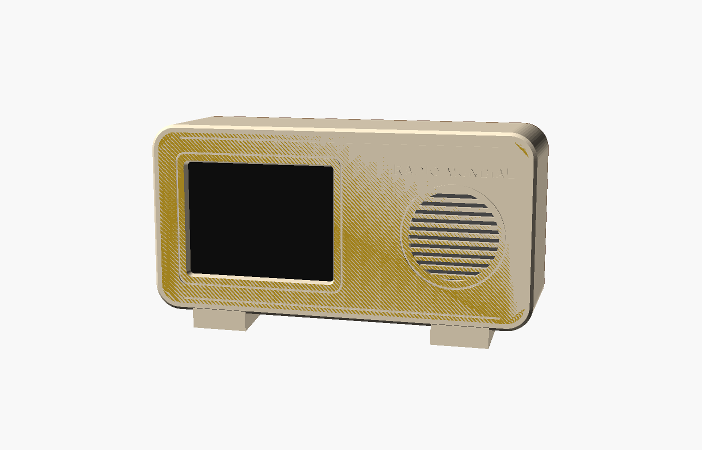
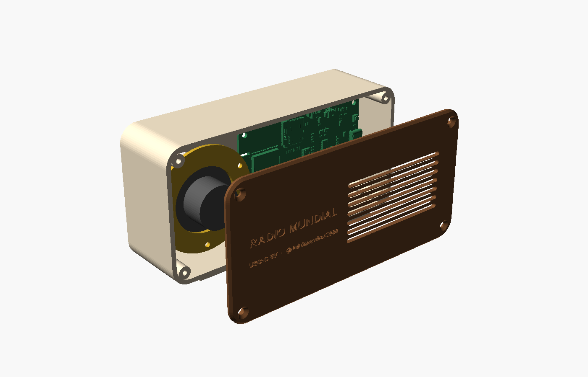

# Radio Mundial — 3D printed case

*[Español más abajo](#español)*

A 1950s–60s style tabletop radio case: screen on the left, a 40 mm round speaker behind a slotted grille on the right, and an 8° backward tilt.
It is about **150 × 74 × 45 mm**.

## Parts (`stl/`)

| File | What it is | Print |
|---|---|---|
| `front_fnk0104.stl` | Body for the **Freenove FNK0104** (ESP32-S3) | Face down, no supports |
| `front_cyd.stl` | Body for the **CYD FNK0114F** (ESP32) | Face down, no supports |
| `back_cover.stl` | Back cover with vents | Outer face down |
| `speaker_ring.stl` | Ring that clamps the speaker | Flat |

Suggested settings: PLA, 0.2 mm layers, 3 walls, 15–20 % infill.
The body is printed with the front on the bed, so the grille, the bevelled window and the engraved details need no supports. The USB-C hole is small enough to bridge.

## Hardware

- 4 × M3 self-tapping screws for the board: **M3 × 6** (FNK0104) or **M3 × 5** (CYD), so they do not reach the front face.
- 4 × M3 × 10 countersunk self-tapping screws (back cover).
- 3 × M2.5 × 5 self-tapping screws (speaker ring).
- 1 × 40 mm round speaker, 4–8 Ω, 1–3 W.
  The FNK0104 accepts up to 2 W at 4 Ω or 1.5 W at 8 Ω, through a 1.25 mm connector.
- Optional: a thin foam ring between the speaker and the front, for a better seal.

## Assembly

1. Put the speaker in its round seat behind the grille and screw the ring on top.
2. Place the board with the screen against the window and the **USB-C to the left** (seen from the front), then screw it to the 4 posts.
3. Plug in the speaker, close the back cover and plug a USB-C cable through the left side.

The microSD slot and the BOOT/RESET buttons stay inside. Remove the back cover to reach them; the web installer does not need them.

## Editing

`radio.scad` is parametric (OpenSCAD 2021.01 or newer).
Change `placa` (`"fnk0104"` or `"cyd"`), the sizes, the tilt or the engraved text, then export each part with `pieza = "frente" | "tapa" | "aro"`.

- `comprobar_choque.scad` intersects the body with a board model to look for collisions.
- `stl_a_step.py` converts the STL files to STEP for SolidWorks or other CAD software (`pip install cadquery-ocp`). The STEP files are faceted and large, so they are not kept in the repository.

> **FNK0104 measurements are from its spec sheet and still need checking on the real board.**
> The CYD fit was checked against Freenove's 3D model: no collisions.

License: CC BY-NC-SA 4.0 — @Adriancubas1980

---

## Español

Carcasa de radio de sobremesa al estilo de los años 50–60: pantalla a la izquierda, altavoz redondo de 40 mm tras una rejilla de ranuras a la derecha, e inclinada 8° hacia atrás.
Mide unos **150 × 74 × 45 mm**.

### Piezas (`stl/`)

| Archivo | Qué es | Impresión |
|---|---|---|
| `front_fnk0104.stl` | Cuerpo para la **Freenove FNK0104** (ESP32-S3) | Boca abajo, sin soportes |
| `front_cyd.stl` | Cuerpo para la **CYD FNK0114F** (ESP32) | Boca abajo, sin soportes |
| `back_cover.stl` | Tapa trasera con ventilación | Cara exterior sobre la cama |
| `speaker_ring.stl` | Aro que sujeta el altavoz | Plano |

Ajustes recomendados: PLA, capas de 0,2 mm, 3 perímetros y relleno del 15–20 %.

### Tornillería

- 4 tornillos M3 rosca chapa para la placa: **M3 × 6** (FNK0104) o **M3 × 5** (CYD), para que no lleguen a la cara frontal.
- 4 tornillos M3 × 10 avellanados rosca chapa (tapa).
- 3 tornillos M2,5 × 5 rosca chapa (aro del altavoz).
- 1 altavoz redondo de 40 mm, de 4–8 Ω y 1–3 W.
  La FNK0104 admite hasta 2 W a 4 Ω o 1,5 W a 8 Ω, con un conector de 1,25 mm.

### Montaje

1. Coloca el altavoz en su asiento detrás de la rejilla y atornilla el aro encima.
2. Coloca la placa con la pantalla contra la ventana y el **USB-C a la izquierda** (visto de frente), y atorníllala a los 4 postes.
3. Conecta el altavoz, cierra la tapa y enchufa el cable USB-C por el lateral izquierdo.

La ranura microSD y los botones BOOT/RESET quedan dentro: para usarlos se quita la tapa. El instalador web no los necesita.

### Editar

`radio.scad` es paramétrico (OpenSCAD 2021.01 o posterior).
Cambia `placa` (`"fnk0104"` o `"cyd"`), las medidas, la inclinación o los textos, y exporta cada pieza con `pieza = "frente" | "tapa" | "aro"`.
`stl_a_step.py` genera los STEP para SolidWorks.

> **Las medidas de la FNK0104 salen de su hoja de especificaciones y hay que comprobarlas con la placa real.**
> Con la CYD se comprobó el encaje contra el modelo 3D de Freenove: sin choques.
