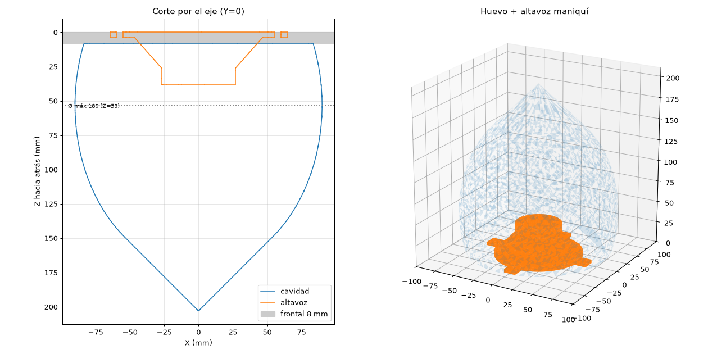

# Radio Mundial Boombox: reference parts

**English** · [Español](#español)

These are **not the case**. They are helper solids to import into SolidWorks (or any CAD) and design the boombox case around them. The case has three sections: two speaker pods and a centre unit with the amplifier and screen.



| File (`referencia/`) | What it is | How to use it |
|---|---|---|
| `huevo_cavidad.step` | Inner volume of one speaker pod (egg shape) | Subtract it from your faceted outer body |
| `altavoz_maniqui.step` | Simplified 4" speaker (ePathChina PS1401S) | Check clearances with ribs and walls |
| `amplificador_bloque.step` | TPA3116D2 board as a bounding block | Lay out the centre unit |

STEP files are exact solids; the STL files are only for viewing.

**Common origin** (egg and speaker fit together automatically): the centre of the **outer face of the baffle**. Z runs along the speaker axis, positive towards the back. When the pod is printed baffle-down, Z is the print height.

**Egg cavity (default values):**
- 3.18 L gross, about **3.08 L net** after the speaker (before ribs and stuffing);
- Ø167 mm at the baffle and Ø180 mm at its widest (Z = 53);
- the back ends in a 45° tip at Z = 203, so it prints without supports.

**Sealed box, about 3 L net:** chosen from the Thiele-Small parameters of similar 4" coaxial speakers (Fs ≈ 107–119 Hz, Qts ≈ 0.64–0.93, Vas ≈ 2.1–2.4 L).

**Dimensions marked (\*) in `referencia.py` are unverified:** they come from the seller's listing or were estimated from photos. The mounting hole diameter (`MONTAJE_DIAMETRO`) is still a placeholder. Measure it, edit the value and run again:

```bash
python referencia.py
```

It needs `pip install cadquery-ocp`. To make the pod shorter, raise `HUEVO_RADIO` or lower `HUEVO_SEMIEJE`: the script prints the new volume.

---

## Español

Esto **no es la carcasa**. Son sólidos de ayuda para importarlos en SolidWorks (u otro CAD) y diseñar alrededor la carcasa del boombox. La carcasa tiene tres secciones: dos cápsulas de altavoz y una unidad central con el amplificador y la pantalla.

| Archivo (`referencia/`) | Qué es | Para qué |
|---|---|---|
| `huevo_cavidad.step` | Volumen interior de una cápsula (forma de huevo) | Restarlo a tu exterior facetado |
| `altavoz_maniqui.step` | Altavoz de 4" simplificado (ePathChina PS1401S) | Comprobar choques con los nervios y las paredes |
| `amplificador_bloque.step` | Placa TPA3116D2 como bloque envolvente | Distribuir la unidad central |

Los STEP son sólidos exactos; los STL son solo para verlos.

**Origen común** (el huevo y el altavoz encajan solos): el centro de la **cara exterior del frontal**. Z va por el eje del altavoz, positivo hacia atrás. Si imprimes la cápsula con el frontal sobre la cama, Z es la altura de impresión.

**Cavidad en huevo (valores por defecto):**
- 3,18 L brutos, **unos 3,08 L netos** descontando el altavoz (sin contar nervios ni guata);
- Ø167 mm en el frontal y Ø180 mm en la parte más ancha (Z = 53);
- la trasera termina en una punta a 45° en Z = 203, así que se imprime sin soportes.

**Caja cerrada de unos 3 L netos:** elegida con los parámetros Thiele-Small de coaxiales de 4" parecidos (Fs ≈ 107–119 Hz, Qts ≈ 0,64–0,93, Vas ≈ 2,1–2,4 L).

**Las cotas marcadas (\*) en `referencia.py` no están verificadas:** salen de la ficha del vendedor o están estimadas de fotos. El Ø del agujero de montaje (`MONTAJE_DIAMETRO`) es provisional. Mídelo, cambia el valor y vuelve a ejecutar:

```bash
python referencia.py
```

Necesita `pip install cadquery-ocp`. Para hacer la cápsula más corta, sube `HUEVO_RADIO` o baja `HUEVO_SEMIEJE`: el script te dice el volumen nuevo.
