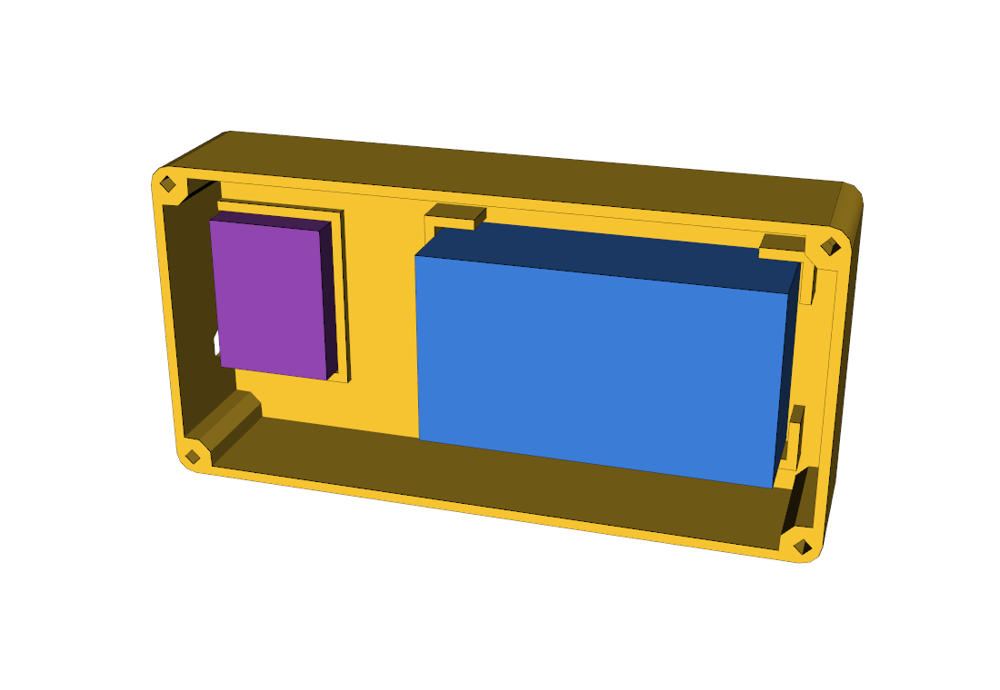

# Radio Mundial — case with DAC and battery («backpack»)

*[Español más abajo](#español)* · **Work in progress: not printed or tested yet.**

A deeper back cover for the [small case](../pequena/) that holds a **PCM5102A DAC
with a line-out jack** and a **battery**. The front is **unchanged**: the backpack
replaces the flat back cover and uses the same 4 screw holes.

| File | What it is |
|---|---|
| `mochila_dac.step` / `.stl` / `.3mf` | The backpack, in print orientation (bottom on the bed) |
| `mochila_dac_montaje.step` | The same part in the front's coordinates, to check the assembly in CAD |
| `mochila_dac.py` | Parametric model (CadQuery): every size is a variable at the top |
| `vistas.py` | Renders the views in `img/` |

**Inside:**
- **Battery:** 2 × 18650 **in parallel** (1S, 68 × 38 × 22 mm, with 1 mm clearance), lying behind the board in a cradle of four corner brackets. Vent slots above it.
- **DAC:** WCMCU-5102 (32.5 × 24 mm) in a low frame, with its jack flush against the right-hand wall and an 8 mm hole for the cable.
- **Two rear feet** at the same height as the front's feet, so the radio stands level. Centre of gravity checked: it does not tip over.

**Size:** the whole radio is about 130 × 69 × 44 mm (front 18 mm + backpack 26 mm).

**Screws:** 4 × M3 × 10 mm from the back, in counterbores (5 mm of the screw goes into the front).

**Print:** PETG, bottom of the backpack on the bed, open side up, no supports.

**To check on the first print:** the height of the jack hole (`JACK_ALTURA`), the DAC frame, and the gap between the battery and the speaker.

Wiring: [`boombox/fnk_conexion`](../../boombox/fnk_conexion/) (PDF guide).

Rebuild: `python mochila_dac.py` and `python vistas.py` (needs CadQuery).

License: **CC BY-NC-SA 4.0**.

---

## Español

**En desarrollo: aún sin imprimir ni probar.**

Tapa trasera más profunda para la [carcasa pequeña](../pequena/), con sitio para un
**DAC PCM5102A con salida de jack** y una **batería**. El **frontal no cambia**: la
mochila sustituye a la tapa plana y usa los mismos 4 tornillos.

| Archivo | Qué es |
|---|---|
| `mochila_dac.step` / `.stl` / `.3mf` | La mochila, ya orientada para imprimir (fondo sobre la cama) |
| `mochila_dac_montaje.step` | La misma pieza en los ejes del frontal, para comprobar el montaje en CAD |
| `mochila_dac.py` | Modelo paramétrico (CadQuery): todas las medidas son variables al principio |
| `vistas.py` | Genera las vistas de `img/` |

**Dentro:**
- **Batería:** 2 × 18650 **en paralelo** (1S, 68 × 38 × 22 mm, con 1 mm de holgura), tumbada detrás de la placa en una cuna de cuatro esquinas, con rejilla de ventilación encima.
- **DAC:** WCMCU-5102 (32,5 × 24 mm) en un marco bajo, con el jack a ras de la pared derecha y un agujero de 8 mm para el cable.
- **Dos patas traseras** a la misma altura que las del frontal: la radio apoya nivelada. Centro de gravedad comprobado: no se vuelca.

**Tamaño:** la radio entera mide unos 130 × 69 × 44 mm (frontal de 18 mm + mochila de 26 mm).

**Tornillos:** 4 × M3 × 10 mm por detrás, en cajeados (entran 5 mm en el frontal).

**Impresión:** PETG, el fondo de la mochila sobre la cama, abierta hacia arriba, sin soportes.

**A comprobar en la primera impresión:** la altura del agujero del jack (`JACK_ALTURA`), el marco del DAC y la distancia entre la batería y el altavoz.

Conexiones: [`boombox/fnk_conexion`](../../boombox/fnk_conexion/) (guía en PDF).

Regenerar: `python mochila_dac.py` y `python vistas.py` (hace falta CadQuery).

Licencia: **CC BY-NC-SA 4.0**.
