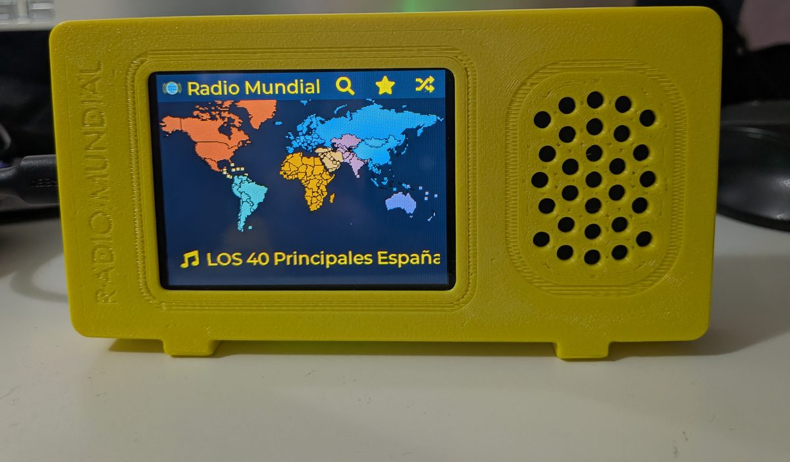

# Radio Mundial — small case

*[Español más abajo](#español)*

A compact case for the **Freenove FNK0104** that uses the small speaker that comes with the board. The front measures **130 × 69 × 17 mm**, plus a 4 mm back cover. Designed in SolidWorks by @Adriancubas1980.

## Files

| File | What it is |
|---|---|
| `front.3mf`, `front.stl` | Front, with the screen window and the speaker grille |
| `back_cover.3mf`, `back_cover.stl` | Back cover |
| `front.step`, `back_cover.step` | Editable models, for changing the design |

The `.3mf` and `.stl` files are already in their print orientation.

## Print

PETG, 0.2 mm layers, 0.4 mm nozzle, 6 walls, 15 % infill, **no supports**.
On a Bambu Lab P2S: front about 1 h and 31 g, back cover about 45 min and 18 g.

## Hardware

- 4 × M3 × 5 mm screws for the board (M3 × 4 also works). **Not longer than 5 mm**: the posts are 4 mm deep and a 6 mm screw hits the bottom.
- 4 × M3 × 8 mm screws for the back cover.
- The board's speaker. Its cable is short: lengthen it by soldering a piece of two-wire cable (with heat-shrink tubing), or buy the same kind of speaker with a longer cable.
- Optional: hot glue to hold the speaker behind the grille.

Assembly steps with photos: [manual](https://adriancubasalvarez.github.io/radio-mundial/manual/#build).

License: **CC BY-NC-SA 4.0** (see [`LICENSE-CONTENIDO.md`](../../LICENSE-CONTENIDO.md)).

---

## Español

Carcasa compacta para la **Freenove FNK0104** que usa el altavoz pequeño que trae la placa. El frontal mide **130 × 69 × 17 mm**, más una tapa trasera de 4 mm. Diseñada en SolidWorks por @Adriancubas1980.

### Archivos

| Archivo | Qué es |
|---|---|
| `front.3mf`, `front.stl` | Frontal, con la ventana de la pantalla y la rejilla del altavoz |
| `back_cover.3mf`, `back_cover.stl` | Tapa trasera |
| `front.step`, `back_cover.step` | Modelos editables, para modificar el diseño |

Los `.3mf` y `.stl` ya están orientados para imprimir.

### Impresión

PETG, capa de 0,2 mm, boquilla de 0,4 mm, 6 perímetros, relleno del 15 %, **sin soportes**.
En una Bambu Lab P2S: frontal en 1 h y 31 g, tapa trasera en 45 min y 18 g.

### Tornillería y piezas

- 4 tornillos M3 × 5 mm para la placa (M3 × 4 también vale). **No más largos de 5 mm**: los postes tienen 4 mm de fondo y uno de 6 mm toca el fondo.
- 4 tornillos M3 × 8 mm para la tapa trasera.
- El altavoz de la placa. Su cable es corto: alárgalo soldando un trozo de cable de dos hilos (con funda termorretráctil), o compra un altavoz igual con el cable más largo.
- Opcional: silicona caliente para sujetar el altavoz detrás de la rejilla.

Pasos del montaje con fotos: [manual](https://adriancubasalvarez.github.io/radio-mundial/manual/es/#montar).

Licencia: **CC BY-NC-SA 4.0** (ver [`LICENSE-CONTENIDO.md`](../../LICENSE-CONTENIDO.md)).
